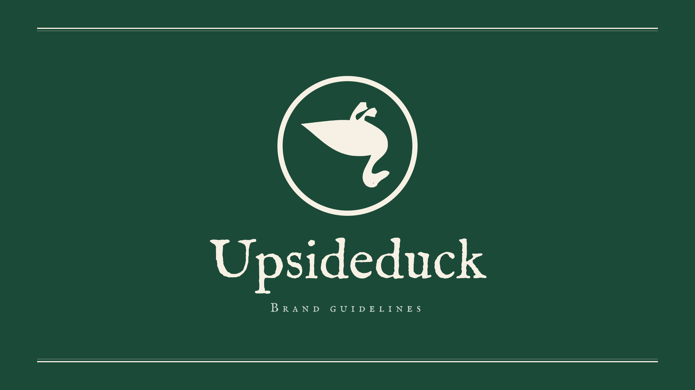
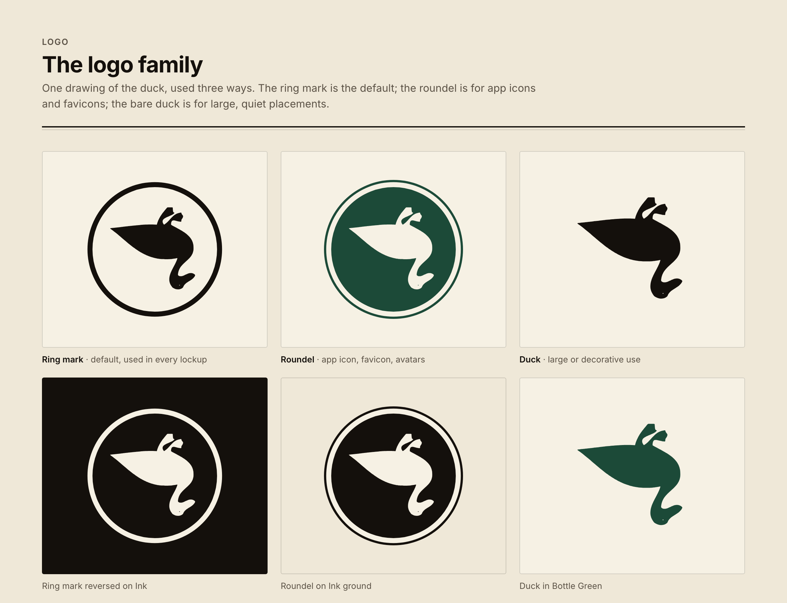
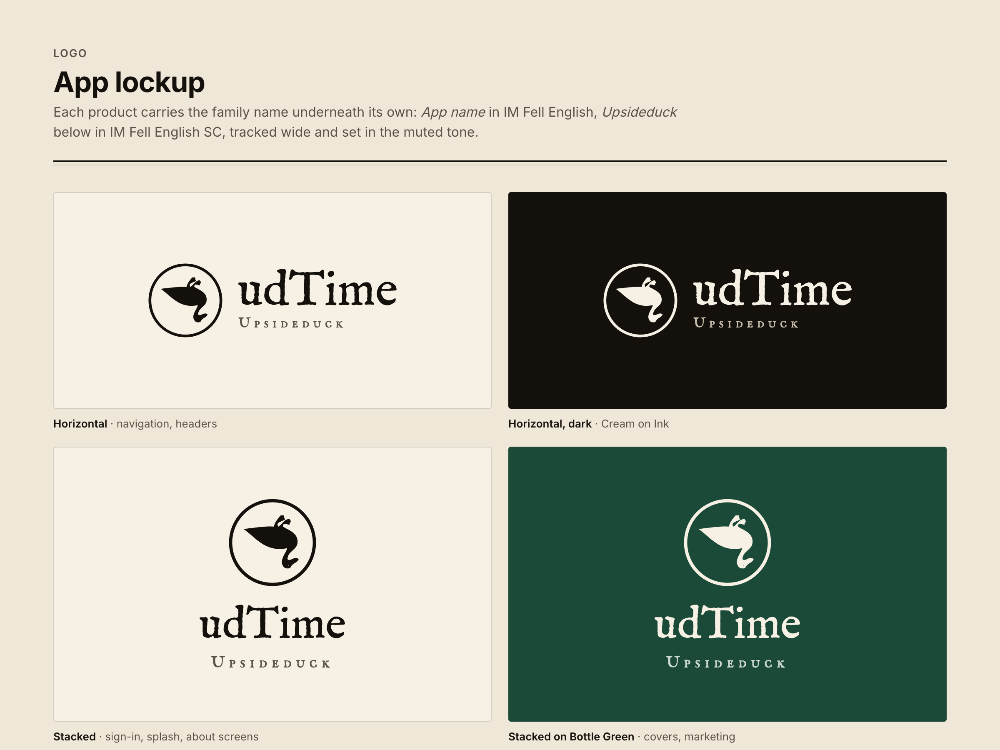
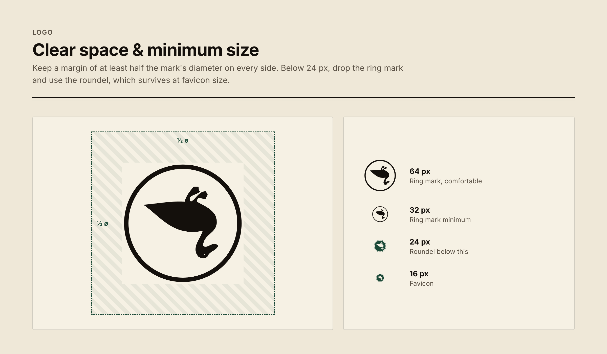
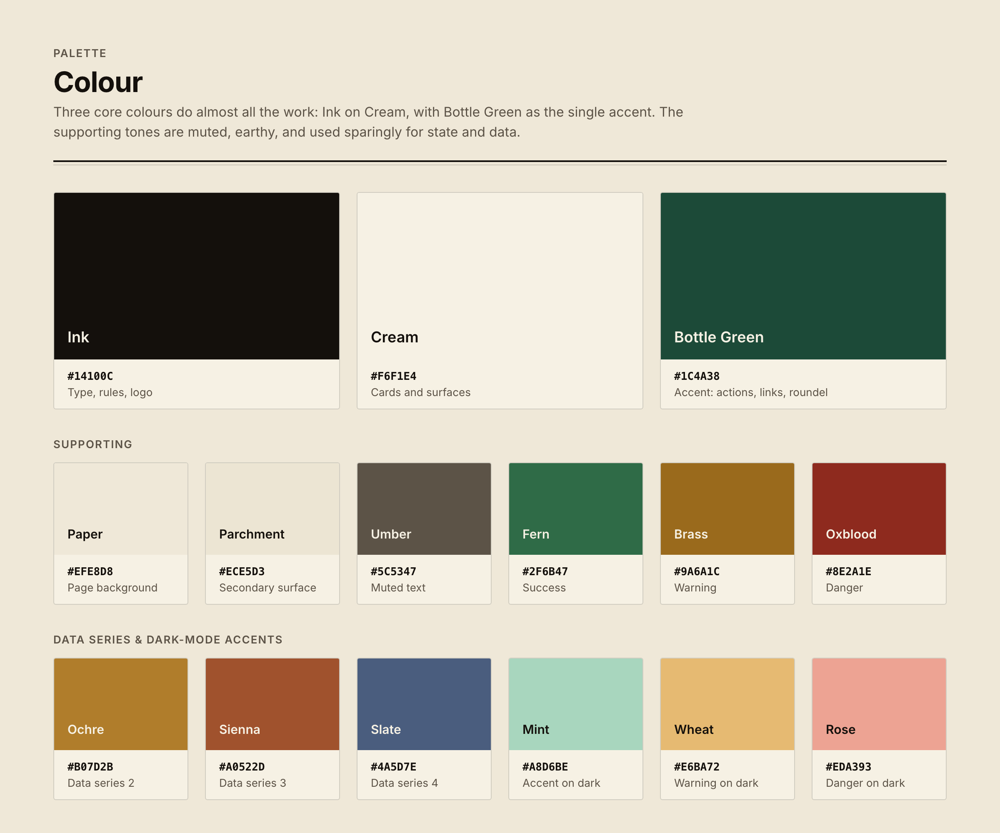
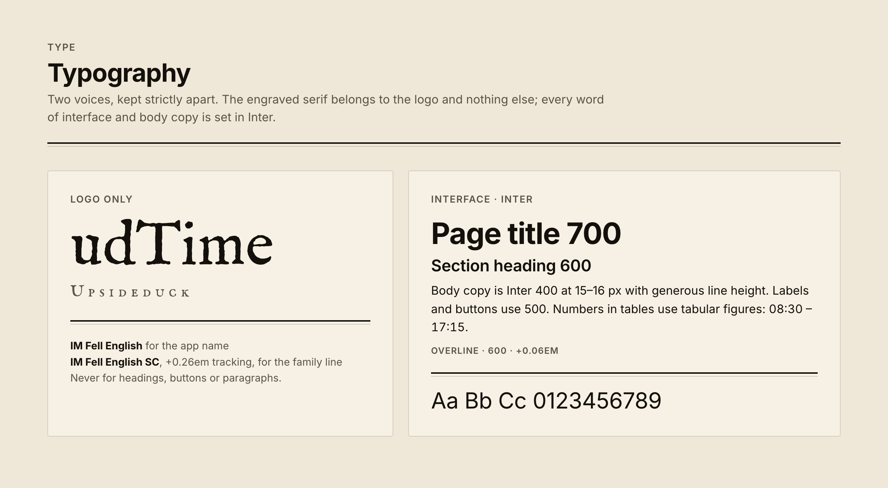
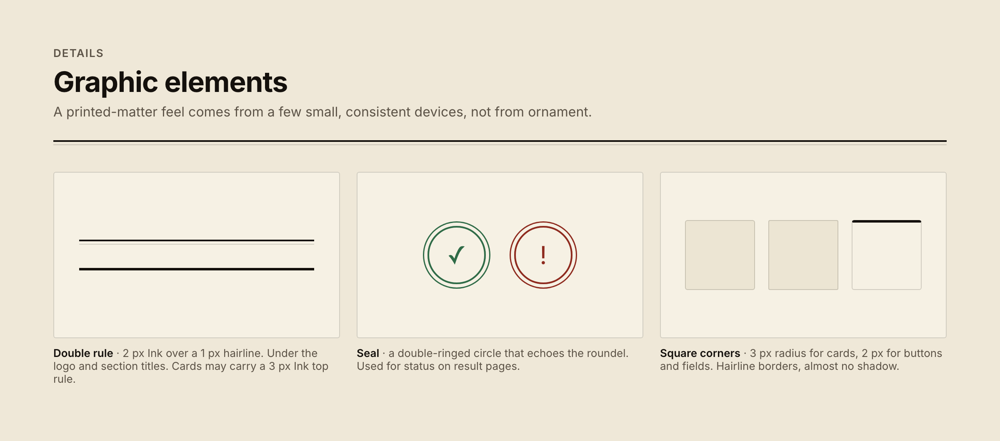
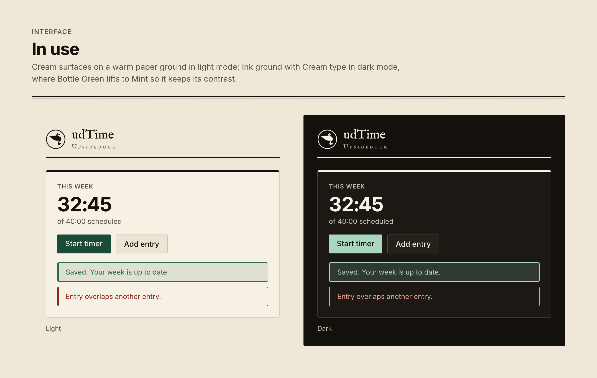
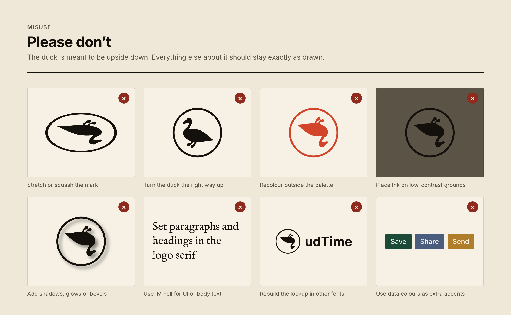

# Upsideduck brand guidelines



Upsideduck is a small family of apps (udTime is the first). The look borrows from old printed matter: an engraved duck, warm paper, black ink and one deep green, with square corners. Everything else stays quiet, so the content carries the page.

This folder is self-contained. Copy it into any project to get the logos, colours, fonts and tokens it needs.

---

## 1. Logo



There is one drawing of the duck, and it is **upside down on purpose**. It is used in three forms:

| Form | Use it for | Files |
|---|---|---|
| **Ring mark**: the duck in a thin circle | The default. Used in every app lockup, headers and navigation. | `logo/svg/mark-{ink,cream,green}.svg` |
| **Roundel**: the duck on a filled disc with an inset ring | App icons, favicons, avatars, and anything under 24 px | `logo/svg/roundel-{green,ink,cream}.svg` |
| **Duck**: the bare silhouette | Large, quiet placements such as empty states, covers and watermarks | `logo/svg/duck-{ink,cream,green}.svg` |

Use the Ink version on light grounds and the Cream version on Ink or Bottle Green. Bottle Green artwork is for Cream grounds only.

### App lockup



Each product puts its own name with the family name underneath:

- **App name**: IM Fell English, at the cap height of the mark.
- **Family line**: "Upsideduck" in IM Fell English SC (small caps), tracked +0.26em, in the muted tone (Umber `#5C5347` on light, `#C4BBA9` on dark).
- **Mark**: the ring mark sits left of the text (horizontal) or centred above it (stacked).

Ready-made udTime lockups are in `logo/svg/lockup-*.svg` and `logo/png/lockup-*.png`. To make one for a new app, change the app name in `source/build.py` (`lockup_svg("udTime", …)`) and rebuild, or use the HTML pattern below.

```html
<a class="brand" href="/" aria-label="AppName, an Upsideduck app">
  <span class="brand-mark" aria-hidden="true"></span>
  <span class="brand-text">
    <span class="brand-name">AppName</span>
    <span class="brand-family">Upsideduck</span>
  </span>
</a>
```

```css
.brand        { display: flex; align-items: center; gap: .7rem; color: var(--app-text); }
.brand-mark   { width: 2.4rem; height: 2.4rem; background: currentColor;
                mask: url("logo/svg/mark-ink.svg") center / contain no-repeat; }
.brand-text   { display: flex; flex-direction: column; line-height: 1; }
.brand-name   { font-family: var(--font-logo); font-size: 1.55rem; letter-spacing: .01em; }
.brand-family { font-family: var(--font-logo-caps); font-size: .72rem; letter-spacing: .26em;
                color: var(--app-muted); margin-top: .3rem; }
```

The mark is applied as a CSS mask with `currentColor`, so it follows the text colour and switches with the theme automatically.

### Clear space and minimum size



- Keep at least **half the mark's diameter** clear on every side.
- The ring mark should be **32 px minimum**. Below 24 px, switch to the **roundel**, which holds up at 16 px favicon size.

---

## 2. Colour



### Core: these three do almost all the work

| | Name | Hex | Role |
|---|---|---|---|
| ■ | **Ink** | `#14100C` | Text, rules, the logo. The dark-mode ground. |
| ■ | **Cream** | `#F6F1E4` | Cards and surfaces. Reversed logo. Text in dark mode. |
| ■ | **Bottle Green** | `#1C4A38` | The **single** accent, used for primary actions, links, focus, selection and the roundel. |

### Supporting

| Name | Hex | Role |
|---|---|---|
| Paper | `#EFE8D8` | Page background (light) |
| Parchment | `#ECE5D3` | Secondary surface, secondary buttons |
| Field | `#FBF8F0` | Input backgrounds |
| Umber | `#5C5347` | Muted text, labels, family line |
| Fern | `#2F6B47` | Success |
| Brass | `#9A6A1C` | Warning |
| Oxblood | `#8E2A1E` | Danger |

### Data series

Use these in this order: **Bottle Green `#1C4A38`**, **Ochre `#B07D2B`**, **Sienna `#A0522D`**, **Slate `#4A5D7E`**. They are for charts, calendars and legends only, never for buttons or as extra accents.

### Dark mode

On dark, the ground becomes Ink and type becomes Cream. The accents lift so they keep their contrast: Bottle Green becomes **Mint `#A8D6BE`**, warning becomes **Wheat `#E6BA72`** and danger becomes **Rose `#EDA393`**. Surfaces step up in warm near-blacks: `#1C1813`, then `#252019`.

All values are in [`tokens.css`](tokens.css) and [`tokens.json`](tokens.json).

---

## 3. Typography



There are two typefaces, and they are kept strictly apart.

**IM Fell English / IM Fell English SC: logo only.** The engraved serif is used for the app name and the family line in the lockup, and for nothing else. Don't use it for headings, buttons, body copy or "decorative" italics.

**Inter: everything else.** Turn on the `cv11` and `ss01` features.

| Style | Weight | Size | Tracking |
|---|---|---|---|
| Page title | 700 | 1.6rem / 26 px | −0.02em |
| Section heading | 600 | 1.1–1.25rem | −0.01em |
| Body | 400 | 15–16 px | 0 |
| Labels, buttons, nav | 500 | 0.8–0.92rem | 0 |
| Overline / nav section | 600 | 0.7rem, uppercase | +0.06em |
| Numbers in tables and timers | any | any | `font-variant-numeric: tabular-nums` |

The fonts are in [`fonts/`](fonts/). All three are under the SIL Open Font License, so they can ship with any project. They are also on Google Fonts:

```html
<link rel="stylesheet" href="https://fonts.googleapis.com/css2?family=Inter:wght@300;400;500;600;700&family=IM+Fell+English&family=IM+Fell+English+SC&display=swap">
```

---

## 4. Graphic elements



- **Double rule**: a 2 px Ink line over a 1 px hairline, like a rule in a printed ledger. It goes under the logo in sidebars and under page headers. A heavy card can carry a single 3 px Ink rule along its top edge instead.
- **Seal**: a circle with a double ring, which echoes the roundel. It marks status on result pages such as success, error or registration.
- **Corners and depth**: corners are nearly square, with a 3 px radius for cards and 2 px for buttons and inputs. Borders are hairlines (Ink at 16% opacity). There is effectively no shadow: 1 px at 5% on light, none on dark.
- **Alerts**: a hairline border with a 3 px left edge in the state colour, on a soft tint of the same colour.
- **Selection**: Cream text on Bottle Green.

---

## 5. In use



- The page sits on Paper, and content sits on Cream cards. Keep to one level of surface nesting, and use Parchment for anything inside a card.
- Primary buttons are solid Bottle Green with Cream text. Secondary buttons are Parchment with a hairline border.
- Give each view one primary action. If everything is green, nothing stands out.
- Set browser theme colours to Cream (light) and Ink (dark):

```html
<meta name="theme-color" content="#F6F1E4" media="(prefers-color-scheme: light)">
<meta name="theme-color" content="#14100C" media="(prefers-color-scheme: dark)">
<link rel="icon" href="logo/svg/roundel-green.svg" type="image/svg+xml">
```

---

## 6. Please don't



- Turn the duck the right way up. It is upside down on purpose, and that's the name.
- Stretch, squash, rotate or redraw the mark.
- Recolour it outside Ink, Cream and Bottle Green.
- Put Ink artwork on mid-tone grounds. Use Cream artwork or the roundel instead.
- Add shadows, glows, gradients or bevels.
- Use IM Fell for UI or body text, or rebuild the lockup in another typeface.
- Use the data colours as extra accent colours.

---

## What's in this folder

```
brand/
├── README.md                 this guide
├── tokens.css                CSS custom properties (light + [data-theme="dark"])
├── tokens.json               the same values for JS, Figma Tokens, native apps
├── fonts/                    Inter, IM Fell English, IM Fell English SC (woff2, OFL)
├── logo/
│   ├── svg/                  duck-*, mark-*, roundel-* (ink/cream/green), lockup-*
│   └── png/                  transparent PNGs: 1024 and 256 px marks, 4× lockups
├── images/                   the guideline sheets shown above (2× PNG)
└── source/
    ├── build.py              regenerates every file above
    └── duck.path             the master duck outline (SVG path data)
```

**Notes on the files**

- The mark, roundel and duck SVGs are pure vector paths with a 1000 × 1000 viewBox and no fonts, so they are safe for any tool.
- The lockup SVGs embed the Fell fonts as data URIs. They render correctly in browsers. For Figma, Illustrator or Keynote, install the fonts from `fonts/` or use the lockup PNGs.
- To make a favicon `.ico` or an Apple touch icon, export from `roundel-green.svg`.

**Rebuilding.** Edit the palette or names at the top of `source/build.py`, then run:

```sh
python3 -I brand/source/build.py          # needs Google Chrome for the PNGs
python3 -I brand/source/build.py --no-png # SVGs and tokens only
```
